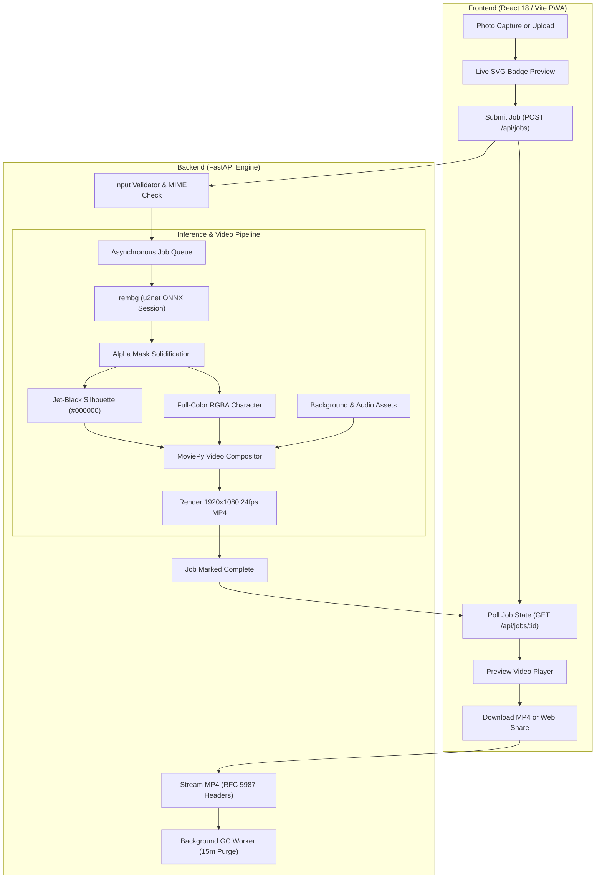

<p align="center">
  
</p>

<p align="center">
  <a href="https://github.com/AtaCanYmc/who-is-that-pykemon/actions/workflows/ci.yml"></a>
  
  
  
  
  
  <a href="LICENSE"></a>
</p>

<p align="center">
  <a href="https://vercel.com/new/clone?repository-url=https://github.com/AtaCanYmc/who-is-that-pykemon&env=VITE_API_URL&envDescription=Backend%20API%20URL%20for%20video%20generation">
    
  </a>
</p>

Asynchronous video synthesis engine and Progressive Web App that generates Pokemon commercial transition reveal meme videos from portrait images using neural network background isolation, procedural audio composition, and MoviePy.

## Table of Contents

- [System Architecture](#system-architecture)
- [Quick Start (Docker)](#quick-start-docker)
- [Technical Mechanics](#technical-mechanics)
- [Local Development Setup](#local-development-setup)
- [API Reference](#api-reference)
- [Configuration](#configuration)
- [Technical FAQ](#technical-faq)
- [Testing & Verification](#testing--verification)
- [Repository Structure](#repository-structure)
- [Governance & Security](#governance--security)

## System Architecture



## Quick Start (Docker)

Launch the complete application stack including backend video synthesis and frontend PWA:

```bash
# 1. Clone the repository
git clone https://github.com/AtaCanYmc/who-is-that-pykemon.git
cd who-is-that-pykemon

# 2. Initialize environment configuration
cp .env.example .env

# 3. Build and launch services in background
docker compose up --build -d

# 4. Verify backend health
curl -f http://localhost:8000/health
```

Access the user interfaces:
- Frontend PWA: `http://localhost:3000`
- Backend REST API: `http://localhost:8000`
- Interactive OpenAPI Docs: `http://localhost:8000/docs`

## Technical Mechanics

### 1. Neural Subject Isolation & Silhouette Generation
- The service processes portrait images using `rembg` backed by the `u2net` ONNX model.
- An alpha channel transfer function solidifies subject boundaries to prevent semitransparent halos.
- A secondary image processor derives a jet-black silhouette (`RGB: 0, 0, 0`) while preserving the exact alpha transparency mask of the isolated character.

### 2. Timeline Video Composition (MoviePy)
The output video is rendered at 1920x1080 resolution at 24 frames per second with H.264 video and AAC audio encoding:
- **Stage 1 (0.0s to 3.3s)**: Jet-black silhouette displayed over rotating rayburst background accompanied by teaser music.
- **Stage 2 (3.3s to 6.77s)**: Full-color character reveal accompanied by announcement text banner (*"IT'S [NAME]!"*) and victory fanfare.
- Custom fonts (Solid, Hollow, Arcade, Sans) and theme palettes (Kanto Classic, Johto Gold, Cyber Neon) are rendered dynamically with dual stroke passes.

### 3. Asynchronous Job Queue & Temporary Storage
- Video rendering is compute-intensive. To prevent HTTP connection timeouts, clients submit requests to `/api/jobs` and poll job status at 500ms intervals.
- Temporary video files are tracked with unique identifiers in `TEMP_DIR`.
- A background garbage collection thread scans `TEMP_DIR` every 5 minutes and deletes files older than 15 minutes.

### 4. Internationalization & Character Sanitization
- Filenames containing Turkish and international Unicode characters are encoded according to RFC 5987. Both ASCII fallbacks and UTF-8 encoded names are provided in the `Content-Disposition` header.
- The frontend provides locale support for English and Turkish with uppercase normalization.

## Local Development Setup

### Prerequisites
- Python 3.11 or later
- Node.js 20 or later with npm
- FFmpeg installed and available in `$PATH`

### Backend Service

```bash
cd backend
python -m venv .venv
source .venv/bin/activate
pip install -r requirements.txt
uvicorn app.main:app --reload --port 8000
```

Refer to [backend/README.md](backend/README.md) for module details.

### Frontend Application

```bash
cd frontend
npm ci
npm run dev
```

Refer to [frontend/README.md](frontend/README.md) for UI architecture.

## API Reference

### Core Endpoints

| Method | Path | Description | Response |
| :--- | :--- | :--- | :--- |
| `GET` | `/health` | Service health status and version | `{"status": "ok", ...}` |
| `GET` | `/api/themes` | List of supported visual themes | Array of theme objects |
| `POST` | `/api/jobs` | Submit video synthesis job | `HTTP 202` with `job_id` |
| `GET` | `/api/jobs/{job_id}` | Poll processing state and progress | Job status object |
| `GET` | `/api/jobs/{job_id}/download` | Download completed MP4 video | `video/mp4` stream |
| `POST` | `/generate-video` | Synchronous legacy video generation | Direct `video/mp4` stream |

### Job Creation Request

```http
POST /api/jobs HTTP/1.1
Content-Type: multipart/form-data

file: <binary image file (JPEG, PNG, WEBP, max 15MB)>
name: "Bulbasaur"
theme: "classic"
font_style: "solid"
```

## Configuration

Environment variables can be supplied via `.env` or system environment:

| Variable | Target | Default | Description |
| :--- | :--- | :--- | :--- |
| `TEMP_DIR` | Backend | `/tmp/who_is_that_pykemon` | Directory for intermediate renders and job outputs. |
| `VITE_API_URL` | Frontend | `http://localhost:8000` | Target URL for backend API requests. |

## Technical FAQ

### How does the service operate if asset files are missing?
The backend includes a procedural asset generator in `app/utils/assets_init.py`. If `background.png` or `whos_that_pokemon.mp3` are missing from `backend/assets/`, the service generates a geometric rayburst canvas and an 8-bit chiptune audio track using Pillow, NumPy, and SciPy.

### Can video generation run completely offline?
Yes. On initial execution, `rembg` downloads the `u2net.onnx` weights into the user cache directory (`~/.u2net/`). Subsequent executions run entirely offline with no external network calls.

### What are the compute requirements for video rendering?
Video synthesis runs on CPU using FFmpeg and ONNX Runtime. A dual-core modern CPU processes a 6.77-second video in approximately 2 to 5 seconds. Systems must have at least 2 GB of available RAM for image tensor transformations.

### How does disk cleanup prevent storage exhaustion?
The application initializes a background worker on startup. The worker executes every 5 minutes and unlinks files in `TEMP_DIR` with modification timestamps older than 900 seconds.

## Testing & Verification

Run automated test suites across subsystems:

```bash
# Backend pytest suite with coverage
pytest backend/tests/ -v --cov=backend/app

# Frontend type checking and production build
npm test --prefix frontend
npm run build --prefix frontend
```

## Repository Structure

```text
who-is-that-pykemon/
├── backend/                  # FastAPI video rendering service
│   ├── app/                  # Application routes, services, and utilities
│   ├── assets/               # Fonts, audio files, and background images
│   ├── tests/                # Pytest unit and integration test suite
│   ├── Dockerfile            # Multi-stage Python backend container
│   ├── requirements.txt      # Python dependencies
│   └── README.md             # Scoped backend documentation
├── frontend/                 # React 18 TypeScript PWA
│   ├── src/                  # Components, i18n translations, sound utilities
│   ├── public/               # Static icons and PWA manifest
│   ├── Dockerfile            # Multi-stage Nginx frontend container
│   ├── package.json          # Node dependencies and scripts
│   ├── vite.config.ts        # Vite and PWA configuration
│   └── README.md             # Scoped frontend documentation
├── docs/
│   └── images/               # Documentation banner and diagrams
├── scripts/                  # Governance, grounding, and anti-slop linters
├── .github/
│   ├── workflows/            # GitHub Actions CI, release, and governance automation
│   ├── ISSUE_TEMPLATE/       # Structured issue forms (bug report, feature request)
│   ├── PULL_REQUEST_TEMPLATE/# Pull request verification checklist
│   └── CODEOWNERS            # Pull request review routing
├── .editorconfig             # Cross-editor formatting specifications
├── .env.example              # Sample environment configuration template
├── .gitattributes            # Line ending normalization and asset tags
├── .gitignore                # Git ignore rules
├── .markdownlint.json        # Markdown linting configuration
├── .pre-commit-config.yaml   # Pre-commit git hook configuration
├── .pre-commit-hooks.yaml    # Reusable pre-commit hook definitions
├── CONTRIBUTING.md           # Contribution workflow and commit conventions
├── LICENSE                   # MIT open-source license
├── Makefile                  # Developer workflow automation targets
├── ROADMAP.md                # Version milestones and technical roadmap
├── SECURITY.md               # Vulnerability disclosure policies
└── docker-compose.yml        # Multi-container orchestration definition
```

## Governance & Security

- **Contributing**: Review [CONTRIBUTING.md](CONTRIBUTING.md) for branch naming and Conventional Commit specifications.
- **Security**: Review [SECURITY.md](SECURITY.md) for vulnerability reporting channels and SLA commitments.
- **Roadmap**: Review [ROADMAP.md](ROADMAP.md) for completed and planned milestones.
- **License**: Released under the [MIT License](LICENSE).
